<div align="center">

# Maxim Novikov — Portfolio

**Персональный сайт-портфолио с собственной админ-панелью и системой аналитики**

Next.js 16 · React 19 · TypeScript · ASP.NET Core (.NET 10) · PostgreSQL · Docker

[](https://maxim-novikov.site)


<br />

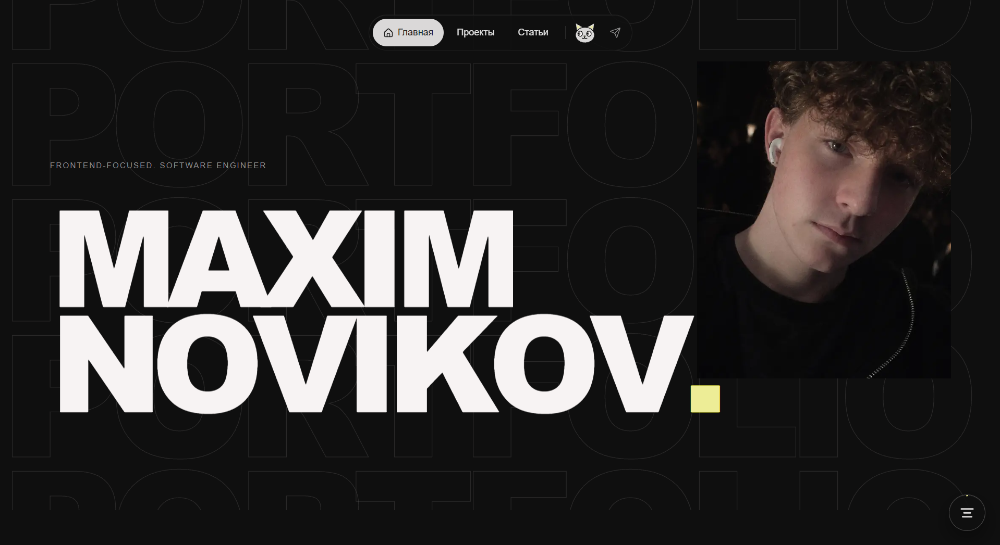

</div>

---

## Содержание

- [О проекте](#о-проекте)
- [Скриншоты](#скриншоты)
- [Возможности](#возможности)
- [Технологии](#технологии)
- [Архитектура](#архитектура)
- [Структура репозитория](#структура-репозитория)
- [Подходы и соглашения](#подходы-и-соглашения)
- [Админ-панель](#админ-панель)
- [Собственная аналитика](#собственная-аналитика)
- [SEO и метаданные](#seo-и-метаданные)
- [Интернационализация](#интернационализация)
- [Запуск](#запуск)
- [Переменные окружения](#переменные-окружения)
- [Деплой](#деплой)
- [Дорожная карта](#дорожная-карта)

---

## О проекте

Это не шаблон и не конструктор: весь сайт написан с нуля, от интерфейса до базы данных. Идея проекта в том, чтобы совместить визуально сильный портфолио-сайт с реальной инженерной основой: чистой архитектурой, типизацией, собственной админкой и собственной аналитикой вместо «чёрного ящика».

Что внутри:

- **Публичный сайт** с анимированными секциями, страницами проектов и статей и круговой навигацией по главной.
- **Админ-панель** с авторизацией: управление статьями (Markdown) и проектами (загрузка изображений, сортировка), дашборд посещаемости и аудитории.
- **Бэкенд на ASP.NET Core** с PostgreSQL, миграциями, rate limiting и защитой админки.
- **Собственная система аналитики**: без хранения IP, с понятным уведомлением посетителю.
- **Готовность к продакшену**: Docker, SEO-метаданные, sitemap, Open Graph, локализация.

## Скриншоты

### Главная страница

| Hero | Проекты |
| :---: | :---: |
|  | 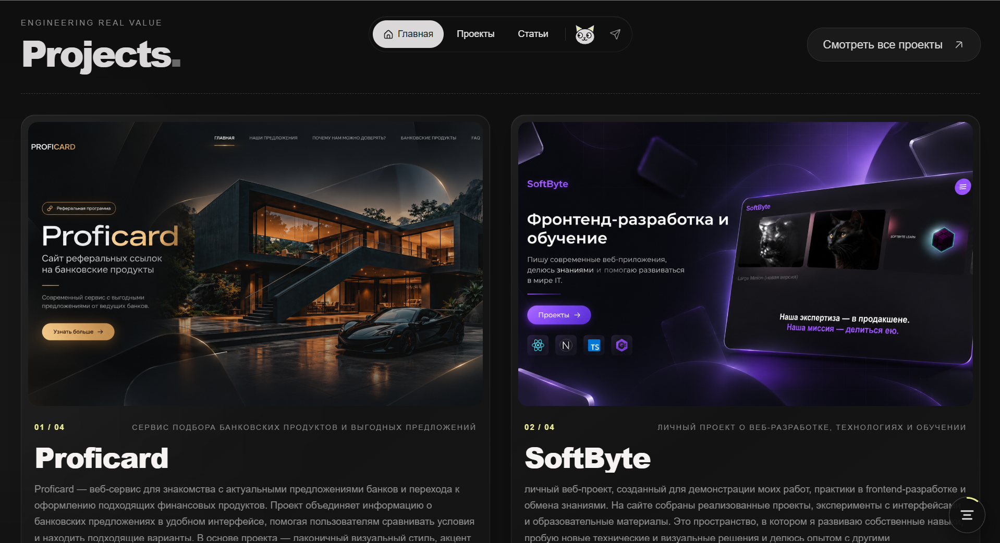 |

| Технологический стек | Опыт |
| :---: | :---: |
| 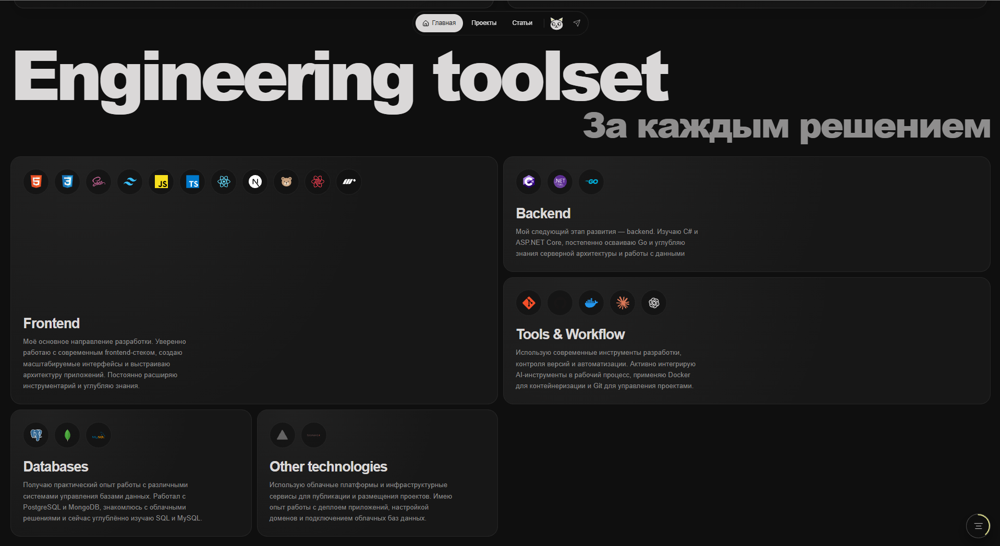 | 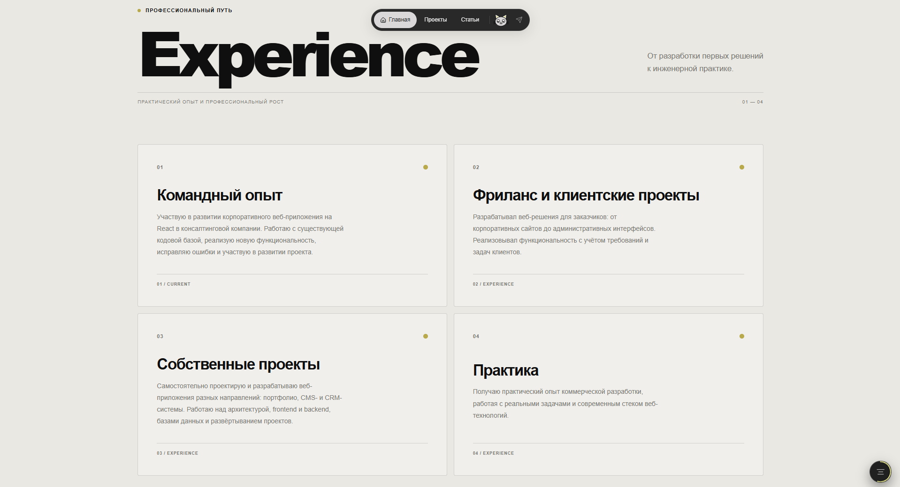 |

| Мысли и статьи | Scenic |
| :---: | :---: |
| 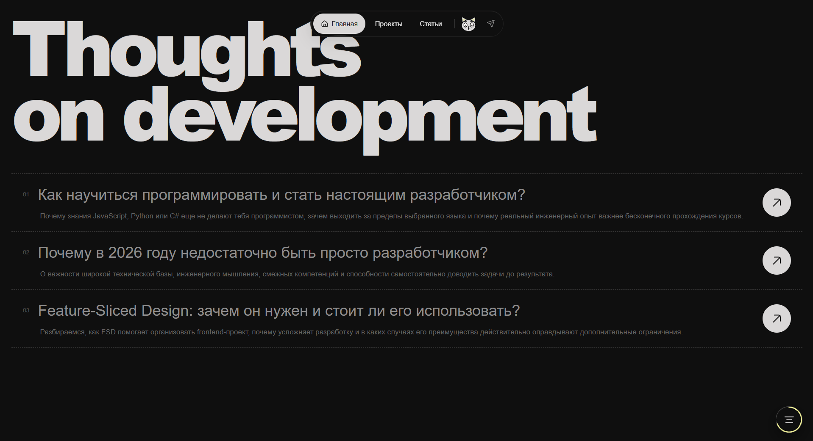 | 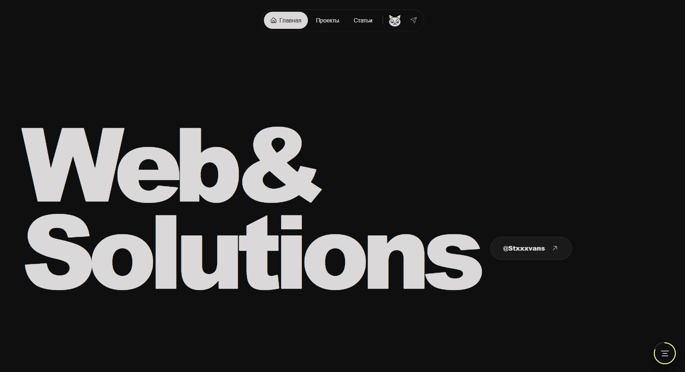 |

### Навигация

| Круговая навигация по секциям | Футер |
| :---: | :---: |
| 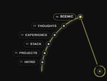 | 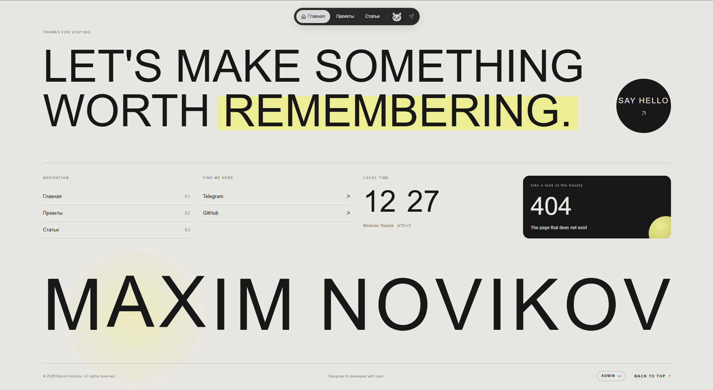 |

### Страницы

| Проекты | Статьи |
| :---: | :---: |
| 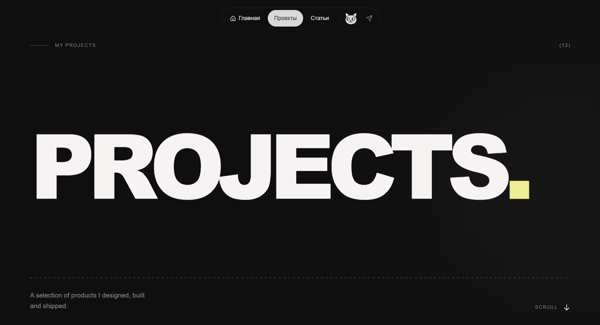 | 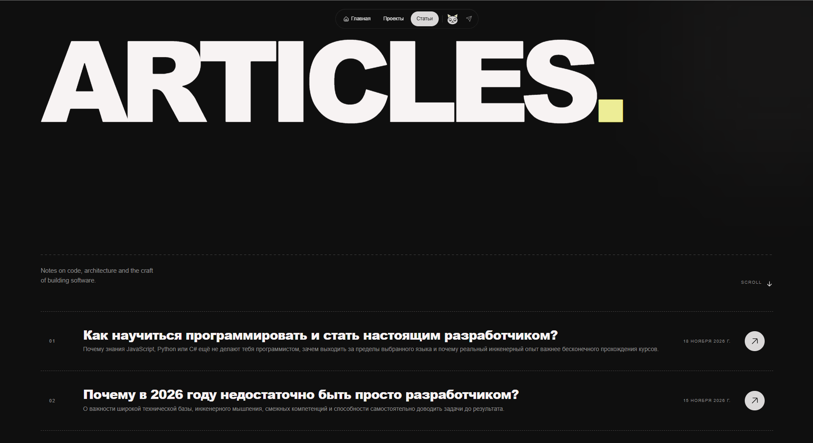 |

| Статья (режим чтения) | 404 |
| :---: | :---: |
| 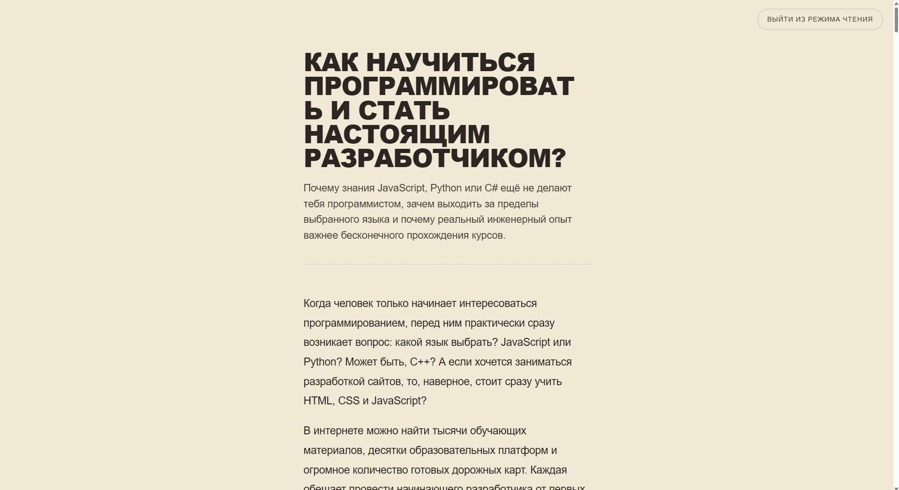 | 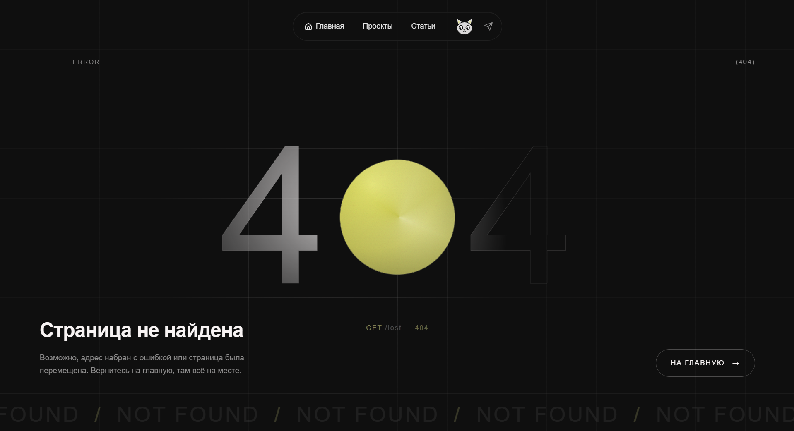 |

### Админ-панель

| Дашборд | Посещения |
| :---: | :---: |
| 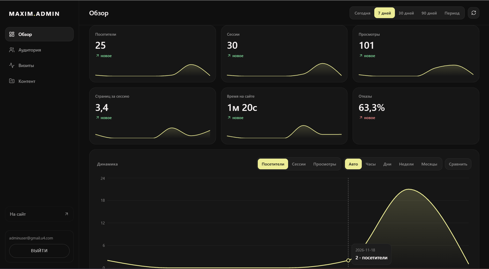 | 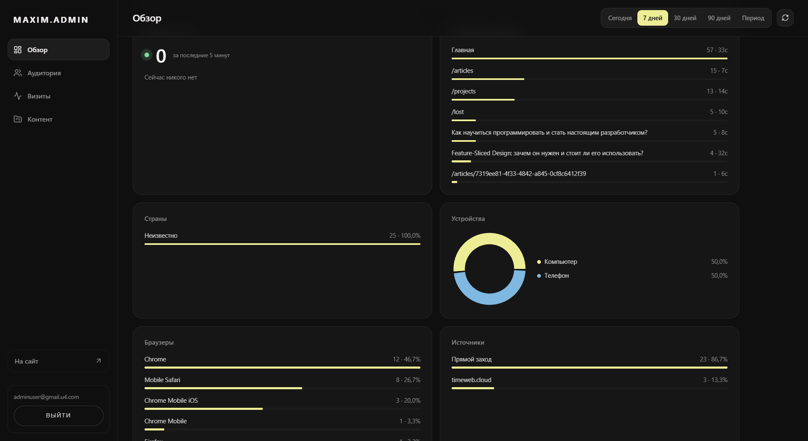 |

| Аудитория | Редактор статьи |
| :---: | :---: |
| 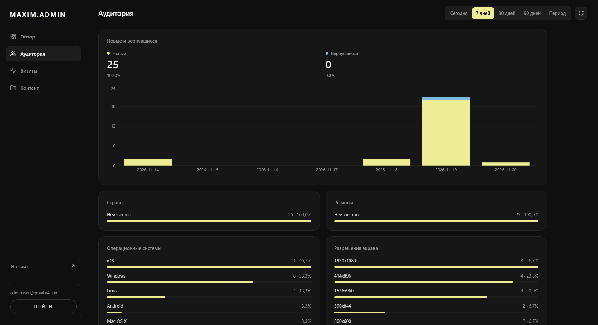 | 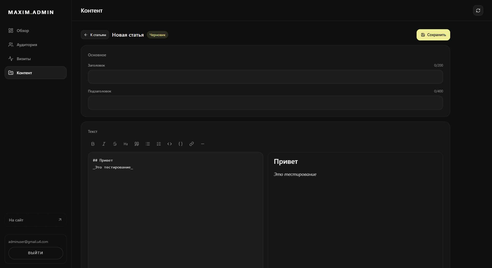 |

| Список проектов | Редактор проекта |
| :---: | :---: |
| 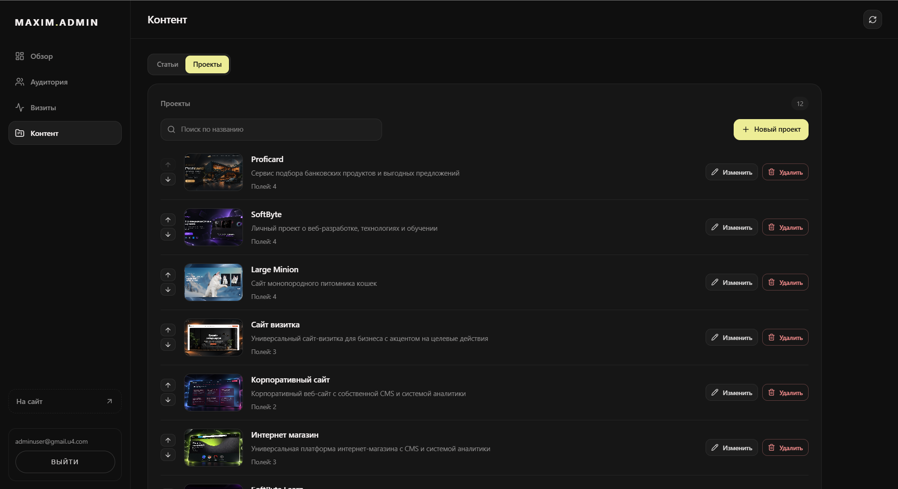 | 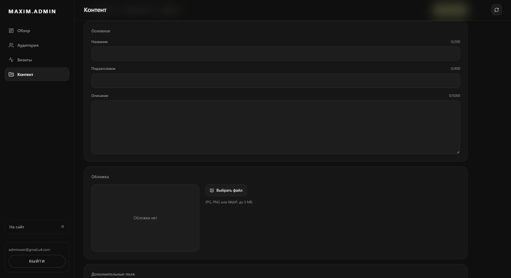 |

## Возможности

### Публичный сайт

- **Главная** из шести секций: Hero, проекты, технологический стек, опыт, мысли и Scenic.
- **Круговая навигация по секциям**: компактная кнопка с кольцом прогресса скролла раскрывается веером узлов по дуге, активная секция подсвечивается стрелкой-индикатором. Скрывается рядом с футером, на тач-устройствах открывается по тапу.
- **Страница проектов** со «стопкой» карточек, которые накладываются друг на друга при скролле.
- **Страница статей** и **страница статьи** с рендером Markdown, режимом чтения и светлой и тёмной темой.
- **Интро-лоадер**, анимации появления (framer-motion), учёт `prefers-reduced-motion`.
- **Уведомление об аналитике**: баннер, который честно говорит, что именно собирается.
- Кастомная страница **404** и скрытая страница `/lost`.

### Админ-панель

- Вход по email и паролю, сессия в HttpOnly cookie.
- Дашборд, посещения, аудитория: графики, фильтры по диапазону дат.
- Управление **статьями**: Markdown-редактор, статистика чтения, подтверждение удаления.
- Управление **проектами**: создание и редактирование, загрузка изображения, drag-and-drop сортировка с оптимистичным обновлением.

### Платформа

- Собственная аналитика посещений (без IP, с определением страны, устройства и источника).
- Метаданные для поисковиков и соцсетей: Open Graph, Twitter Cards, canonical, генерируемые картинки превью и иконки, sitemap и robots.
- Подключены Google Search Console и Яндекс Метрика.
- Все тексты вынесены в словарь для будущей локализации.

## Технологии

### Frontend

| Область | Инструменты |
| --- | --- |
| Фреймворк | **Next.js 16** (App Router), **React 19**, **TypeScript** |
| Стили | **Tailwind CSS 4**, **SCSS Modules** (BEM) |
| Анимации | **framer-motion** |
| Данные | **TanStack Query v5** |
| Локализация | **next-intl** |
| Контент | **react-markdown**, **remark-gfm** |
| Графики | **Recharts** |
| Прочее | lucide-react, date-fns, sonner, country-flag-icons |

### Backend

| Область | Инструменты |
| --- | --- |
| Платформа | **ASP.NET Core**, **.NET 10** |
| База данных | **PostgreSQL 17**, **Entity Framework Core 10**, **Npgsql** |
| Безопасность | Cookie-аутентификация, ASP.NET Data Protection (ключи вне контейнера), rate limiting, CORS, Forwarded Headers |
| Аналитика | MaxMind GeoIP2, UAParser |
| Документация API | OpenAPI + Scalar |

### Инфраструктура

**Docker** и **Docker Compose**: три сервиса (`db`, `backend`, `frontend`), многостадийная сборка фронтенда, бэкенд не публикуется наружу.

## Архитектура

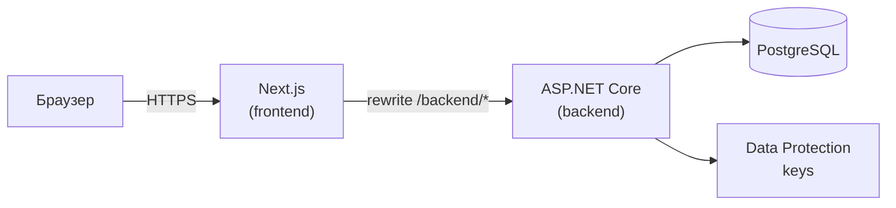

Браузер общается только с Next.js. Запросы по пути `/backend/*` проксируются на бэкенд внутри сети Docker, поэтому бэкенд не торчит наружу, а cookie админки остаётся на том же домене. Серверные компоненты обращаются к бэкенду напрямую по внутреннему адресу.

### Frontend: Feature-Sliced Design

Фронтенд организован по методологии **FSD**. Слои зависят строго сверху вниз:

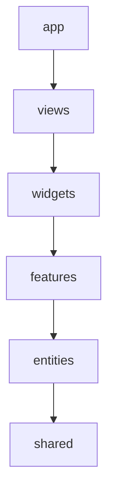

| Слой | Назначение |
| --- | --- |
| `app` | Роутинг Next.js, провайдеры, корневой layout, `sitemap`, `robots`, генерируемые картинки |
| `(views)` | Страницы целиком, композиция виджетов (серверные компоненты) |
| `widgets` | Самостоятельные блоки интерфейса: секции страниц и элементы layout |
| `features` | Пользовательские сценарии: аналитика, авторизация, выбор периода, маскот |
| `entities` | Бизнес-сущности и работа с API: статьи, проекты, аналитика |
| `shared` | Переиспользуемое: UI-кит, хелперы, хуки, конфиг, иконки, i18n |

Правила слоёв, которые соблюдаются в коде:

- виджеты не импортируют другие виджеты, фичи не импортируют другие фичи;
- страницы только собирают виджеты, логики в них нет;
- работа с сетью живёт в `entities/api/*`, интерфейс про `fetch` ничего не знает.

### Устройство виджета

Каждый виджет устроен одинаково, поэтому в любом из них легко ориентироваться:

```
widget/
├─ index.ts              публичный API виджета
├─ model/
│  ├─ config.ts          константы и настройки
│  ├─ data.ts            статические данные
│  ├─ types.ts           типы
│  └─ animations.ts      варианты анимаций
├─ lib/
│  ├─ helpers/           чистые функции
│  └─ hooks/             хуки с логикой
└─ ui/
   ├─ layer/             компоненты (главный и components/*)
   └─ styles/            SCSS-модули
```

Компонент отвечает только за разметку, а вся логика уходит в хуки и хелперы.

### Backend

Классическая слоистая структура ASP.NET Core:

| Папка | Назначение |
| --- | --- |
| `Controllers` | HTTP-эндпоинты: `Articles`, `Projects`, `Analytics`, `Admin` |
| `Services` | Бизнес-логика: сбор и чтение аналитики, GeoIP, классификатор User-Agent, сид администратора |
| `Models` | Сущности EF Core: `Article`, `Project`, `Visitor`, `VisitSession`, `PageView`, `AdminUser` |
| `Dtos` | Контракты запросов и ответов с валидацией |
| `Data` | `DbContext` |
| `Migrations` | Миграции БД, применяются автоматически при старте |

## Структура репозитория

```
.
├─ frontend/                      Next.js приложение
│  ├─ messages/                   словари локализации (ru.json)
│  ├─ public/                     статические файлы
│  └─ src/
│     ├─ app/                     роутинг, layout, sitemap, robots, og-картинки
│     ├─ (views)/                 страницы: main, projects, articles, admin-*
│     ├─ widgets/
│     │  ├─ layout/               menu, footer, section-nav, analytics-notice, admin-shell
│     │  └─ sections/             секции страниц по разделам
│     ├─ features/                analytics-tracker, admin-auth, date-range, yandex-metrika
│     ├─ entities/                api-клиенты и типы сущностей
│     └─ shared/                  ui, lib, config, i18n, icons
├─ backend/
│  └─ backend/                    ASP.NET Core API
│     ├─ Controllers/
│     ├─ Services/
│     ├─ Models/
│     ├─ Dtos/
│     ├─ Data/
│     └─ Migrations/
├─ docker-compose.yml             локальный и серверный запуск целиком
├─ docker-compose.timeweb.yml     вариант для хостинга с внешней БД
└─ .env.example                   пример переменных окружения
```

## Подходы и соглашения

- **Чистая архитектура фронтенда.** FSD с жёсткими правилами импортов; страницы не содержат логики.
- **Строгая типизация.** TypeScript везде; словарь переводов типизирует ключи (`Messages: typeof ru`), поэтому опечатка в ключе ломает сборку, а не production.
- **Серверные и клиентские компоненты.** Страницы и метаданные рендерятся на сервере, интерактивные части выделены в клиентские компоненты.
- **Данные через TanStack Query** с общим компонентом `QueryBoundary`, который единообразно обрабатывает загрузку, ошибки и пустые состояния на сайте и в админке.
- **Стили.** Tailwind для базового слоя, SCSS-модули с BEM для компонентов; у админки собственная тёмная тема на CSS-переменных.
- **Анимации с уважением к пользователю.** Везде учитывается `prefers-reduced-motion`; тяжёлые эффекты отключаются.
- **Доступность.** Семантические роли и `aria-*`, управление с клавиатуры (в том числе у круговой навигации), видимый фокус.
- **Безопасность по умолчанию.** HttpOnly cookie, rate limiting на вход и на аналитику, валидация DTO, ограничения на загрузку файлов (тип и размер), бэкенд не публикуется наружу.
- **Конфигурация через окружение.** Секреты только в переменных окружения и GitHub Secrets, никаких паролей в коде.
- **Код без комментариев.** Названия и структура должны объяснять код сами.

## Админ-панель

Доступна по адресу `/admin`, закрыта авторизацией и скрыта от поисковиков (`noindex`).

| Раздел | Что внутри |
| --- | --- |
| **Дашборд** | Сводка ключевых метрик за выбранный период |
| **Посещения** | Динамика визитов, популярные страницы, источники трафика |
| **Аудитория** | Страны, устройства, браузеры, новые и вернувшиеся посетители |
| **Статьи** | Список, Markdown-редактор, оценка времени чтения, удаление с подтверждением |
| **Проекты** | Список с drag-and-drop сортировкой, редактор, загрузка изображения (jpeg, png, webp, до 5 МБ) |

Администратор создаётся при старте из переменных окружения; в режиме разработки данные заполняются тестовыми значениями.

## Собственная аналитика

Вместо готового трекера посещения считаются собственным модулем: данные остаются в своей базе.

**Что собирается:**

- анонимный идентификатор посетителя и сессии (в `localStorage`);
- открытые страницы и активное время на них (heartbeat);
- размер экрана, язык, часовой пояс, браузер и тип устройства;
- источник перехода и UTM-метки;
- страна, определённая по IP.

**Что не собирается:** IP-адрес не сохраняется нигде. Он используется только для rate limiting и в момент определения страны.

Посетитель видит уведомление с подробным списком; отключение не предусмотрено по дизайну, поэтому баннер только информирует. Помимо собственного модуля подключена **Яндекс Метрика** (только в продакшене и не в админке).

## SEO и метаданные

- Метаданные страниц формируются через `generateMetadata` из словаря: title, description, Open Graph, Twitter Cards.
- Картинка для превью ссылок и иконки (`icon`, `apple-icon`) генерируются кодом.
- Динамический **sitemap** (статические страницы и статьи из бэкенда) и **robots**.
- Canonical и абсолютные ссылки строятся от `SITE_URL`.
- Страницы 404, `/lost` и админка закрыты от индексации.
- Подключены Google Search Console и Яндекс Метрика.

## Интернационализация

Все пользовательские тексты лежат в `frontend/messages/ru.json`, разбитые по областям (`menu`, `hero`, `footer`, `meta` и другие). Это сделано заранее, чтобы добавление английского свелось к новому словарю `en.json` и маршрутизации по локали, без переписывания компонентов.

## Запуск

### Через Docker (рекомендуется)

```bash
git clone https://github.com/Maxim-Coder-arch/personal-website.git
cd personal-website

cp .env.example .env
```

Заполни `.env` (см. [переменные окружения](#переменные-окружения)) и запусти:

```bash
docker compose up --build
```

Сайт будет доступен на `http://localhost:3000`, админка на `http://localhost:3000/admin`.

> Cookie админки помечена как `Secure`, поэтому вход работает по HTTPS или на `localhost`.

### Для разработки

**Backend** (нужны .NET 10 SDK и PostgreSQL):

```bash
cd backend/backend
dotnet run
```

Строку подключения и данные администратора задай через user-secrets или переменные окружения. Миграции применяются автоматически при старте.

**Frontend** (нужен Node.js 22+):

```bash
cd frontend
npm install
npm run dev
```

Сайт откроется на `http://localhost:3000`, адрес бэкенда по умолчанию `http://localhost:5062`.

Проверки кода:

```bash
npx tsc --noEmit
npm run lint
```

## Переменные окружения

### Корневой `.env` (Docker Compose)

| Переменная | Назначение |
| --- | --- |
| `DB_PASSWORD` | Пароль PostgreSQL |
| `ADMIN_EMAIL` | Email администратора |
| `ADMIN_PASSWORD` | Пароль администратора |
| `SITE_URL` | Публичный адрес сайта, например `https://maxim-novikov.site` |

### Frontend

| Переменная | Когда нужна | Назначение |
| --- | --- | --- |
| `BACKEND_URL` | сборка (build arg) и запуск | Адрес бэкенда для проксирования и серверных запросов |
| `SITE_URL` | сборка (build arg) и запуск | Домен для canonical, sitemap и Open Graph |
| `NEXT_PUBLIC_TRACKING` | сборка | Значение `off` отключает собственный трекер |

### Backend (основные)

| Переменная | Назначение |
| --- | --- |
| `ConnectionStrings__DefaultConnection` | Строка подключения к PostgreSQL |
| `Admin__Email`, `Admin__Password` | Учётные данные администратора |
| `Proxy__KnownNetworks` | Доверенные сети обратного прокси |
| `DataProtection__KeysPath` | Каталог ключей Data Protection (том Docker) |

> Секреты никогда не коммитятся: они хранятся в `.env` на сервере и в GitHub Secrets.

## Деплой

- Фронтенд собирается многостадийным `Dockerfile`; `BACKEND_URL` и `SITE_URL` передаются как build args, потому что значения встраиваются в сборку.
- Бэкенд и БД работают внутри общей сети Docker, наружу публикуется только фронтенд.
- Ключи Data Protection хранятся в томе (или в базе), чтобы сессии администратора переживали перезапуск контейнеров.
- Перед продакшеном: HTTPS, редирект `http` на `https` и `www` на основной домен.

## Дорожная карта

- [ ] Английская локализация (маршрутизация `[locale]` и словарь `en.json`)
- [ ] Переводы контента статей и проектов на стороне бэкенда
- [ ] Структурированные данные (JSON-LD) для главной и статей
- [ ] Отдельные картинки превью для каждой статьи
- [ ] Человекочитаемые адреса статей (slug)
- [ ] CI/CD через GitHub Actions

</div>